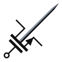
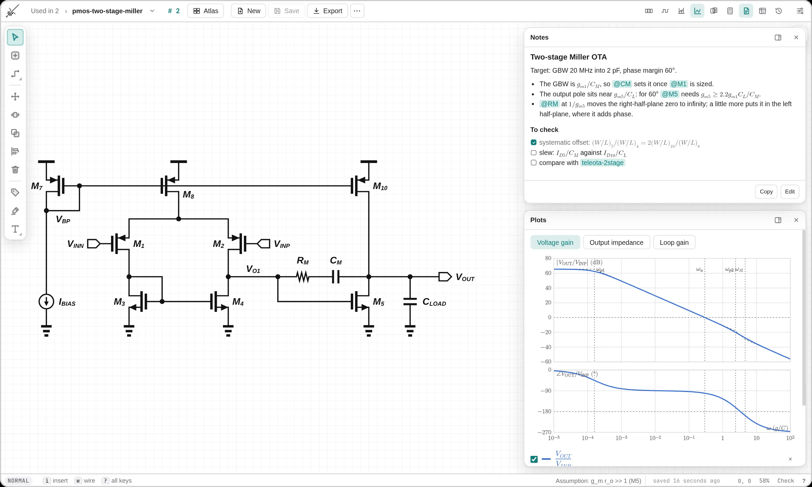
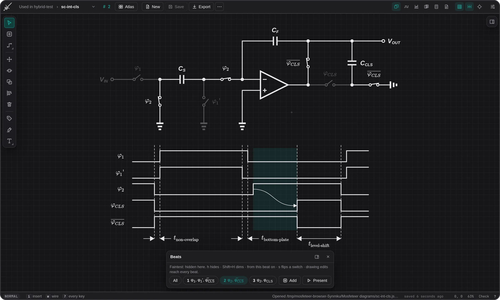
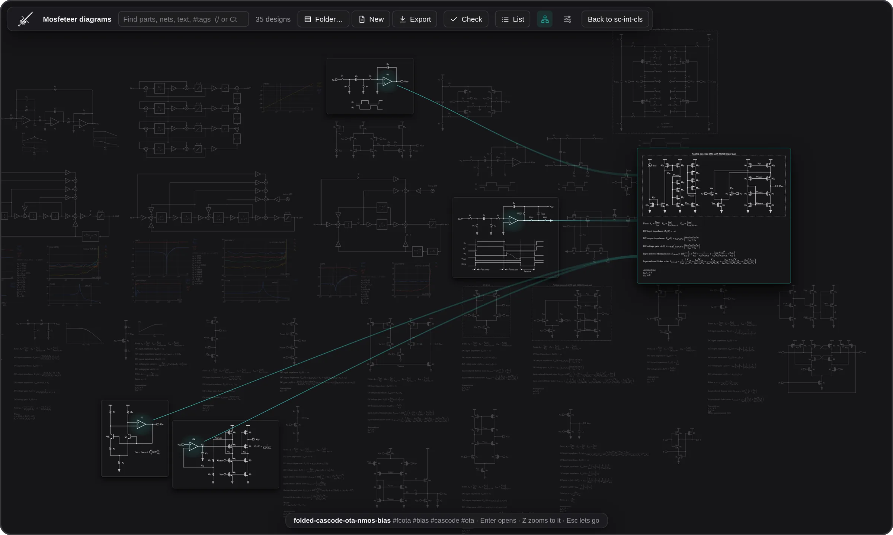

<p align="center">
  <picture>
    <source media="(prefers-color-scheme: dark)" srcset="docs/images/logo-dark.svg">
    
  </picture>
</p>

<h1 align="center">Mosfeteer</h1>

<p align="center">
  <b>A drawing tool for analog circuit schematics.</b><br>
  For figures in papers, slides, and documentation.
</p>

<p align="center">
  
  
  
</p>

<p align="center">
  <a href="#quick-start">Quick start</a> ·
  <a href="#a-design">A design</a> ·
  <a href="#analysis">Analysis</a> ·
  <a href="#keys">Keys</a> ·
  <a href="#more">More</a>
</p>

<br>

<p align="center">
  
</p>

Mosfeteer is for drawing analog schematics as figures and documentation:
quick to draw in, and the result is ready for a paper or slides. Each
drawing can also carry what you worked out about the circuit, such as
notes, derived equations, plots, a timing diagram, and its earlier saves.
A design is one `.json` file in a folder.

## A design

- **Schematic.** Press `i` and type to place a part, `w` to draw a wire.
  Moving a part reroutes only the wires that have to change, so the layout
  stays as you drew it.
- **Notes** (`n`). Markdown with math. `@M1` points at a part or net and
  lights it up on the drawing; `[[amp]]` links to another design.
- **Analysis** (`Shift+S`). Symbolic small-signal results, block-diagram
  transfer functions, and switched-capacitor z-domain responses, described
  [below](#analysis). Equations and plots can be placed on the drawing.
- **Timing and beats** (`Shift+K`, `Shift+B`). A timing diagram of the
  clock phases, and beats that step through the circuit phase by phase,
  with open switches drawn open and what they cut off dimmed. Useful for
  checking a switched-capacitor circuit, and for presenting it.
- **History.** Every save is kept inside the file. Pin the one that works
  as a checkpoint and go back to it later.
- **Links.** A part can stand for another design: an op-amp for its
  transistor-level circuit. Peek at it, open it, or keep it beside you in a
  reference window (`Shift+V`).

<p align="center">
  
</p>

## The workspace

The **Atlas** (`Shift+Backspace`) lays out every design in the folder on
one sheet. Search it for parts, nets, text, or `#tags`. Pick a design and
the ones it links to are drawn joined to it. Open one with a double-click.

<p align="center">
  
</p>

## Analysis

The analysis window (`Shift+S`) picks its mode from what is drawn.

**Small-signal.** Solves a transistor circuit exactly and writes the result
as you would by hand: Z<sub>in</sub>, Z<sub>out</sub>, the gain, poles and
zeros, and input-referred noise. Each symbol links back to the device it
came from. Optional: the loop gain, broken at an op-amp, a terminal, a net,
or between two nets when the loop is not drawn closed; an op-amp's closed
loop split into its ideal gain and direct feedthrough; and the poles' time
constants, one per capacitor. Pick the input and output on the drawing; an
ambiguous pick gets an explanation, not a guess.

**Signal flow.** For block diagrams: gains, sums, H(s) and H(z) blocks,
samplers, and quantizers. Every source's transfer function to the output
comes from one solve, so a delta-sigma modulator's STF and NTF come out
together. Symbols like `a_1` stay symbolic in the equations and get sliders
in the plots.

**Switched-capacitor.** The exact z-domain transfer function of a switched-
capacitor circuit, by charge conservation from phase to phase, with its kT/C
noise. The clock comes from the timing diagram.

The **Plots** window (`Shift+W`) shows magnitude over phase, the step
response, root locus, loop gain with margins, signal swing against input
amplitude, and a time-domain simulation. The **optimizer** searches free
coefficients for the best result that meets your limits (in-band noise,
peaking, pole Q, signal swing).

Also at hand: a **calculator** (`Shift+E`) that reads `1/(2pi*10k*1n)`, and
a **design check** (`x`) for unconnected pins, overlapping nets, and other
slips.

## Quick start

You need [Node.js](https://nodejs.org/) 18 or newer.

```sh
git clone https://github.com/ojarvin/mosfeteer.git
cd mosfeteer
node launch.mjs
```

The editor opens in its own window and quits when you close it.

- **Windows:** double-click `Mosfeteer.cmd`.
- **Linux or macOS:** `node launch.mjs --install` adds Mosfeteer to the
  application menu.
- **No Node?** Open [`browser-only/index.html`](browser-only/index.html)
  directly and pick a folder for your designs (**Open folder…**). Chrome and
  Edge save straight into it. Firefox and Safari can read it but save by
  downloading a copy.

## Keys

| | |
| --- | --- |
| `i` · `w` · `l` | place a part · draw a wire · name a net |
| `n` · `Shift+V` | notes · reference windows |
| `Shift+S` · `Shift+W` | analysis · plots |
| `Shift+K` · `Shift+B` | timing diagram · beats |
| `Shift+E` · `x` | calculator · design check |
| `Shift+Backspace` | the Atlas |
| `Esc` | let go of the selection, then close windows one by one |
| `?` | every other key, the tutorials, and the symbols |

## More

<details>
<summary><b>Files</b></summary>

<br>

Each design is one `.json` file, so it is easy to keep in git or send to
someone, and its notes and save history go with it. New designs go to the
workspace folder, `~/Documents/Schematics` unless you pick another. A design
with no unsaved changes reloads when its file changes on disk, after a
`git pull` for example. **Export** (`Ctrl/Cmd+E`) writes SVG, PDF, or PNG
cropped to the drawing; with a page guide (IEEE single or double column)
the text comes out at the paper's figure size.

</details>

<details>
<summary><b>Scripting</b></summary>

<br>

The editor, the CLI, and the HTTP API use one command language:

```sh
npm run cli -- amp "add nmos M1 --at 120 120"   # edits <workspace>/amp.json
```

</details>

<details>
<summary><b>Development</b></summary>

<br>

```sh
npm run serve   # dev server with auto-restart at http://127.0.0.1:47280/
npm test
```

- [`docs/model.md`](docs/model.md) · [`docs/editor.md`](docs/editor.md): symbols, model rules, and editor behavior
- [`docs/notes-and-history.md`](docs/notes-and-history.md): notes and save history
- [`docs/atlas.md`](docs/atlas.md) · [`docs/hierarchy.md`](docs/hierarchy.md) · [`docs/beats.md`](docs/beats.md): the Atlas, linked designs, beats, and timing diagrams
- [`docs/symbolic-analysis.md`](docs/symbolic-analysis.md) · [`docs/topological-small-signal.md`](docs/topological-small-signal.md): small-signal analysis
- [`docs/signal-flow-analysis.md`](docs/signal-flow-analysis.md) · [`docs/switched-cap-analysis.md`](docs/switched-cap-analysis.md): signal-flow and switched-capacitor analysis, swing, and the optimizer

</details>

## License

[MIT](LICENSE). The bundled Latin Modern Math font in `src/web/fonts/` has its own [GUST Font License](src/web/fonts/GUST-FONT-LICENSE.txt).
