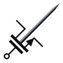
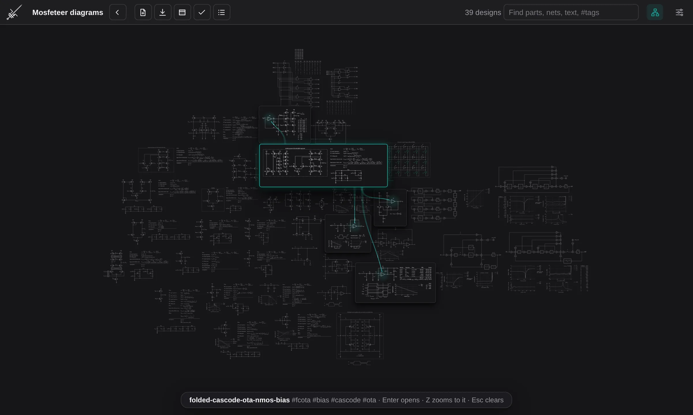
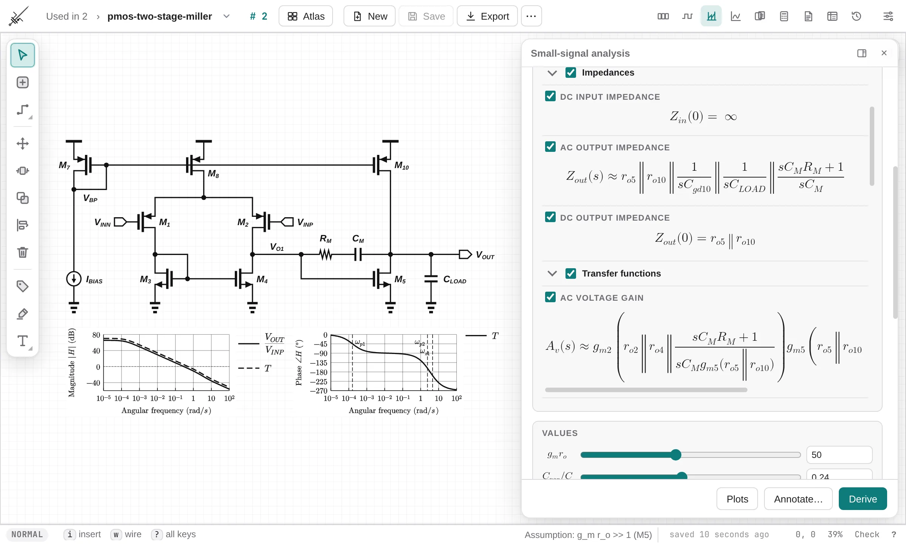
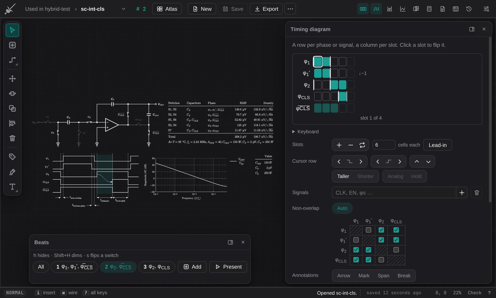

<p align="center">
  <picture>
    <source media="(prefers-color-scheme: dark)" srcset="docs/images/logo-dark.svg">
    
  </picture>
</p>

<h1 align="center">Mosfeteer</h1>

<p align="center">
  <b>A design notebook for analog circuits.</b><br>
  Draw schematics and block diagrams fast, and keep the math, plots, and notes beside them.
</p>

<p align="center">
  
  
  
</p>

<p align="center">
  
</p>

Mosfeteer is a drawing tool for analog designers. Sketch a circuit or a
block diagram, analyze it, and write down what you learn. The drawing is
ready for a paper or a slide. Each design is one small `.json` file.

## Draw

Press `i` and type to place a part, and `w` to draw a wire. Move a part,
and only the wires that must change are rerouted. Transistors, passives,
op-amps, switches, logic gates, and block-diagram parts all share one
grid and one look.

## Analyze

Press `Shift+S` and pick an input and an output. The analysis window has
five modes:

- **Circuit:** the gain, impedances, poles, zeros, and noise of a
  transistor circuit, as equations you would write by hand.
- **Signal flow:** the transfer functions of a block diagram, with step
  response, root locus, swing, and a coefficient optimizer.
- **Switched-cap:** the exact z-domain response of a switched-capacitor
  circuit, with the kT/C noise of every switch.
- **Logic:** the truth table of a gate-level drawing, and each output as a
  minimized sum of products.
- **Synthesis:** a truth table in, the minimized gates drawn out.

Every symbol links back to the part it came from. Plot a result, then
place the plot or the equations on the drawing with one click.

<p align="center">
  
</p>

## Document

Write notes beside the circuit, in Markdown with math. `@M1` points at a
part on the drawing, and `[[amp]]` links to another design. Draw the clock
in the timing diagram tool, then step through it phase by phase: each
phase shows its switches open or closed, with the cut-off parts dimmed.

<p align="center">
  
</p>

Export SVG, PDF, or PNG cut to the drawing. Set the page to an IEEE
column, and the text comes out at the right size. Your notes can become a
report with numbered figures. Each design keeps its own save history.

## Organize

The Atlas, shown at the top, lays out every design in a folder. Search it
for a part, a net, or a `#tag`. Pick a design to see which others use it.
A part can also stand for another design, such as an op-amp for its
transistor-level circuit.

## Install

You need [Node.js](https://nodejs.org/) 18 or newer. There is nothing else
to install.

```sh
git clone https://github.com/ojarvin/mosfeteer.git
cd mosfeteer
node launch.mjs
```

The editor opens in its own window. Press `?` there to see every key and
the tutorials.

- **Windows:** double-click `Mosfeteer.cmd`.
- **Linux or macOS:** run `node launch.mjs --install` to add Mosfeteer to
  your app menu.
- **No Node?** Open [`browser-only/index.html`](browser-only/index.html) in
  your browser and pick a folder for your designs. Chrome and Edge save
  into it. Firefox and Safari save by downloading a copy.

New designs go to `~/Documents/Schematics` unless you pick another folder.

## Development

```sh
npm run serve          # dev server at http://127.0.0.1:47280/
npm test               # unit tests
npm run test:browser   # the editor, driven in headless Chromium
npm run cli -- amp "add nmos M1 --at 120 120"   # script a design
```

The editor, the CLI, and the HTTP API share one command language. The
[`docs/`](docs/) folder describes the model, the editor, and each analysis.

## License

[MIT](LICENSE). The bundled Latin Modern Math font in `src/web/fonts/` has
its own [GUST Font License](src/web/fonts/GUST-FONT-LICENSE.txt).
